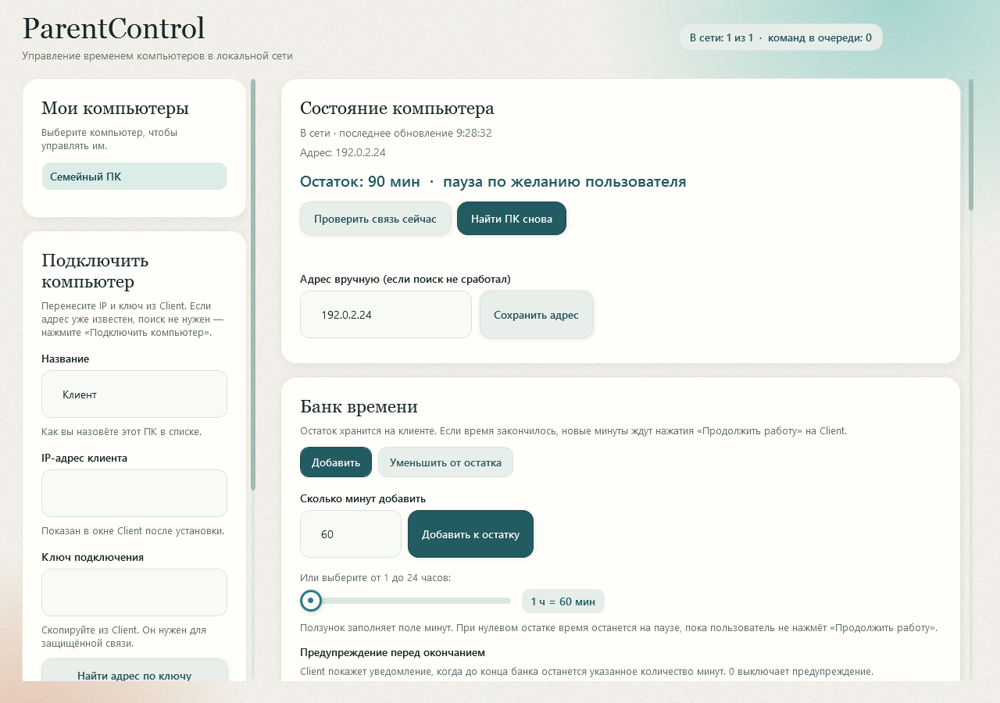
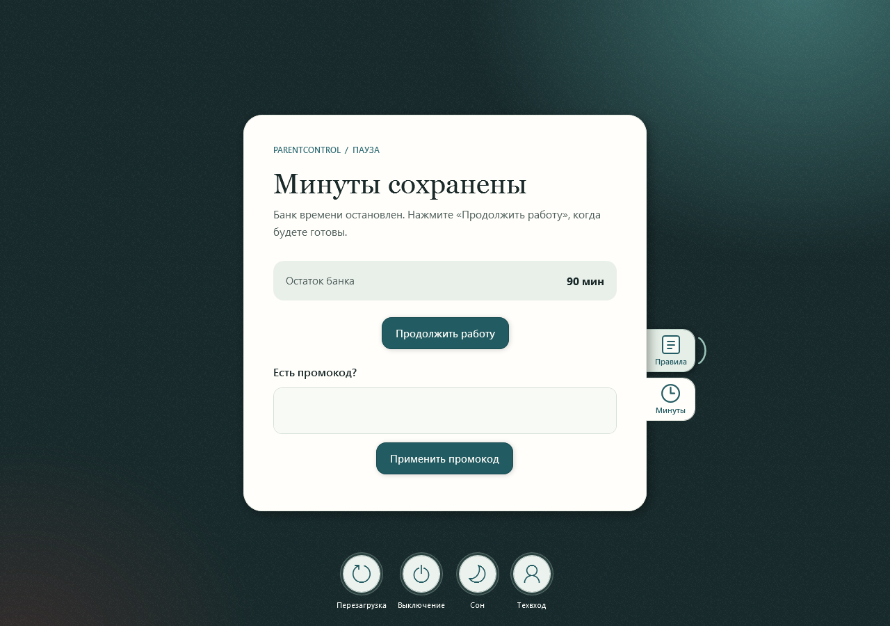

# ParentControl

Управление временем за компьютером в локальной сети. **Windows · Admin + Client · без облака и подписок.**

**[Скачать EXE](https://github.com/MantyZOR/ParentControl/releases/latest) · [Подробная инструкция](docs/GUIDE.md) · [MIT](LICENSE)**

## Как выглядит

**Admin — список компьютеров и банк времени**

**Client — экран блокировки с сохранёнными минутами**

*Превью настоящего интерфейса на демонстрационных данных. Нажмите на изображение, чтобы открыть его крупнее.*

## Что умеет

- Добавлять и отнимать минуты, блокировать ПК вручную.
- Задавать доступ по дням и часам, предупреждать об окончании времени.
- Сохранять минуты на паузе и продолжать работу по кнопке.
- Выдавать промокоды, отправлять правила и выбирать фоны блокировки.
- Находить подключённые ПК при смене IP и доставлять очередь команд.
- Работать автономно на клиенте и сохранять журнал событий.

## Быстрый старт

1. Скачайте два EXE из [релиза](https://github.com/MantyZOR/ParentControl/releases/latest).
2. Установите **Admin** на свой ПК, **ClientApp** — на управляемый.
3. Перенесите IP и ключ из Client в Admin, добавьте минуты.
4. Смените начальный пароль техобслуживания **1234** в Admin и включите защиту на Client.

Оба ПК должны быть в одной частной локальной сети. Runtime .NET уже включён в EXE.

## Как это работает

~~~mermaid
flowchart LR
    A["Admin — ваш ПК"] -->|"Локальная сеть"| C["Client — другой ПК"]
    A --> Q["Очередь команд на Admin"]
    Q -->|"После подключения"| C
    C --> T["Локальный таймер и экран блокировки"]
~~~

При выключенном Admin уже выданные минуты и правила работают. Для доставки новых команд Admin должен быть запущен.

**Ограничение:** пользователь с правами администратора Windows может остановить или удалить Client.

[Установка и обновление](docs/GUIDE.md#установка-из-двух-exe) · [Возможности и настройки](docs/GUIDE.md#возможности-и-настройки) · [Сборка из исходников](docs/GUIDE.md#проверка)
